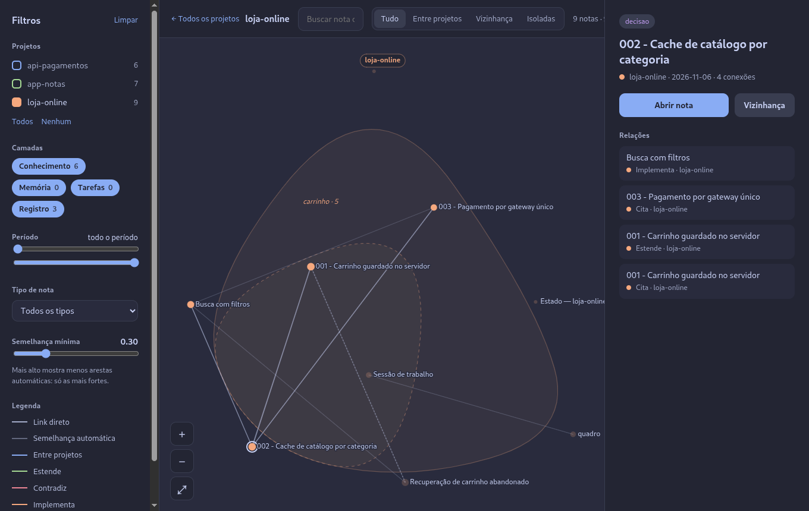
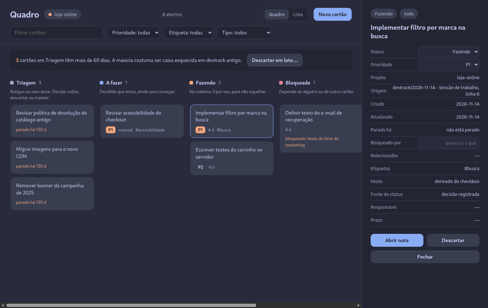
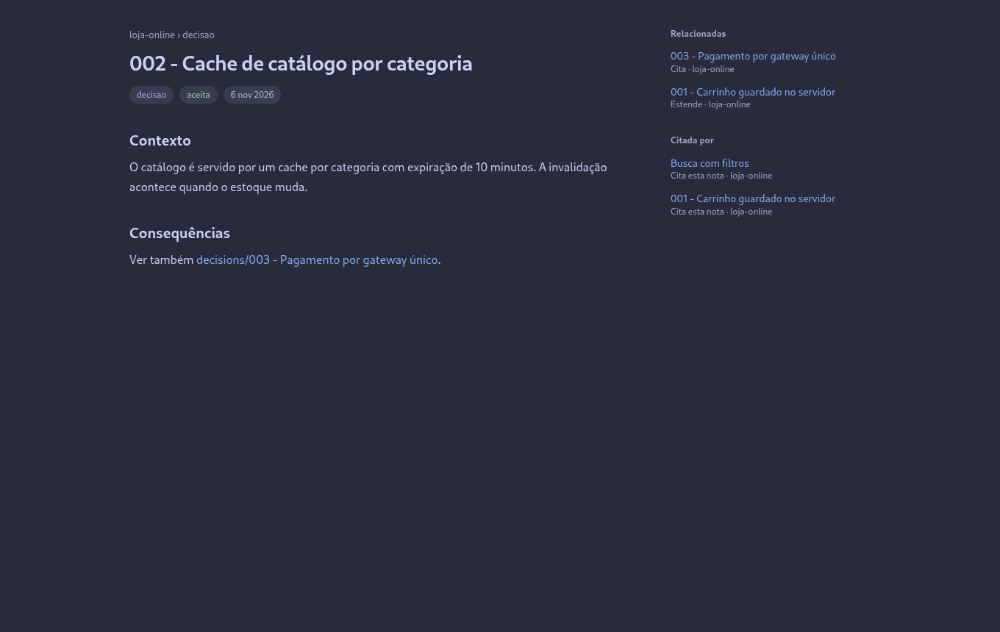
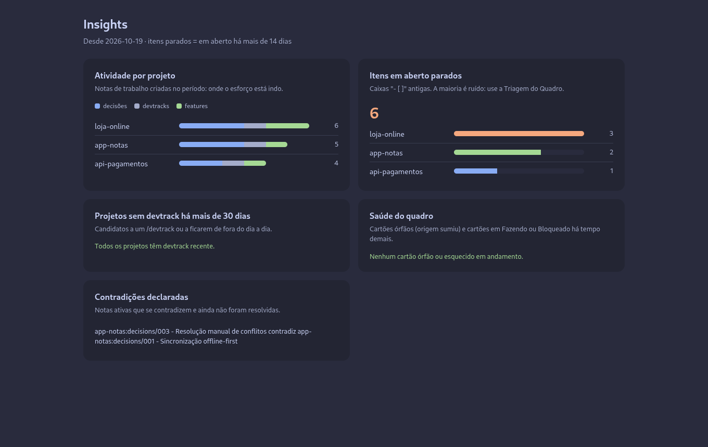

<p align="center"></p>

# secondbrain

Suite de 21 skills para Claude Code que cria e mantém um sistema de memória persistente, documentação e rastreamento de conhecimento para projetos de software, com **memória cruzada entre projetos** e uma **interface nativa para Linux**.

## O que é

O **SecondBrain** é uma camada de conhecimento viva que cresce junto com o projeto. A cada sessão, o Claude sabe exatamente onde o projeto parou, quais decisões foram tomadas e o que está em aberto, sem precisar reexplicar nada. E, quando um problema já foi resolvido em outro projeto seu, ele consegue achar a solução.

Ele une quatro camadas:

- **CLAUDE.md**: instruções, stack e regras do projeto para o Claude Code
- **Vault Obsidian**: documentação local legível por humanos (`{Projeto}SecondBrain/`)
- **Memória Claude Code**: contexto persistente entre sessões (`~/.claude/projects/.../memory/`)
- **Memória cruzada**: um índice sobre todos os vaults, que permite buscar, relacionar e consolidar conhecimento entre projetos

Por padrão o vault fica no `.gitignore` (documentação pessoal de cada dev). Se o projeto preferir versioná-lo junto com o código, o setup pergunta e grava `versionado: true` no manifesto.

---

## Início rápido

```
/plugin marketplace add eltobsjr/secondbrain
/plugin install secondbrain@secondbrain
```

Depois, uma vez, instale as ferramentas locais (índice, interface, atalho e ícones):

```bash
bash <pasta-do-plugin>/scripts/install-tools.sh
```

E, dentro de qualquer projeto no Claude Code:

```
/secondbrain-setup
```

O Claude explora o repositório, faz perguntas e gera a estrutura. Em vaults que já existem, nada é refeito: a primeira skill que rodar adapta o vault (veja "Estrutura modular").

### Rotina sugerida

```
Início da sessão   →  /context
Travou num erro    →  /recall "descrição do problema"
Novo aprendizado   →  /learn  "o que descobriu"
Nova decisão       →  /decision
Final da sessão    →  /devtrack
De vez em quando   →  /audit  e  /patterns
```

---

## Skills (21)

### Workflow diário

| Comando | O que faz |
|---|---|
| `/secondbrain-setup` | Setup inicial: explora o repo, faz perguntas e gera as camadas. Detecta SecondBrain existente e adapta em vez de recriar. `--estrutura` ajusta módulos e pastas; `--import-history` importa o histórico de commits (até 50). |
| `/context` | Briefing compacto de início de sessão: estado, pendências e próxima ação. Usa o `ESTADO.md` e o `digest` da memória cruzada. |
| `/devtrack` | Gera o log da sessão, reescreve o `ESTADO.md`, regenera o `INDEX.md` e reindexa a memória cruzada. |
| `/standup` | Daily standup em 3 blocos (ontem / hoje / bloqueios) |
| `/board` | Quadro kanban das pendências (Triagem, A fazer, Fazendo, Bloqueado, Revisão, Feito, Descartado). Os cartões vêm das caixas `- [ ]` dos vaults; as decisões ficam em `quadro.md` por projeto (formato do Obsidian Kanban), com backup e sem tocar nas notas de origem. Ver, mover, criar e fazer triagem em lote; `--json` para integrações. |
| `/resume` | Revisão completa: o que foi feito, pendências abertas e próxima ação |

### Qual usar quando (as que parecem se repetir)

| Eu quero... | Use | Por quê |
|---|---|---|
| Começar a trabalhar agora (30 segundos) | `/context` | Briefing curto: estado, pendências e próxima ação. Não revisa histórico. |
| Entender tudo o que aconteceu até aqui | `/resume` | Revisão histórica completa; mais lenta e mais longa. |
| Dizer ao time o que fiz | `/standup` | Sai do devtrack mais recente (ontem / hoje / bloqueios). Não olha o quadro. |
| Ver, mover ou criar pendências | `/board` | Quadro interativo (Triagem → Feito); as decisões ficam em `quadro.md`. |
| Uma lista de prioridades escrita no vault | `/priority` | Grava `prioridade/atual.md`. Começa pelo quadro e grava a ordem com `--prioridade`. |

Regra prática: **`/board` é onde a pendência vive; `/priority` é um retrato escrito dela.** Se só quer saber o que fazer agora, `/context`.

### Calendário por semana, prazo e janelas

A página Quadro abre no **Calendário**, na última semana que tem registro: o que foi feito numa semana fica nela (a data de conclusão manda, não a de quando o cartão surgiu), os abertos ficam na semana em que surgiram e podem ser arrastados para outra semana para planejá-los. A **Agenda** agrupa por janela de prazo (atrasadas, hoje, esta semana, próxima, mais adiante, sem prazo), com flags: "vence hoje", "chegando" (3 dias) e "atrasado há N dias". **Dentro do prazo nunca é atrasado, e sem prazo nunca atrasa.** Há visão por projeto e visão global, com filtro por semana, situação e projeto. Na linha de comando: `board semana`, `board agenda`, `board plan`, `board prazo` e `board revisao`. O limite por semana (`quadro-capacidade:`, padrão 7) só avisa. Detalhes na seção 8e da arquitetura.

### Pendência viva, oculta e conciliada

Devtrack é retrato de fim de sessão, e uma caixa `- [ ]` nele fica aberta para sempre se ninguém a reescrever. Em projetos reais, a grande maioria dos itens abertos nunca mais aparece numa sessão seguinte. Por isso o quadro **oculta por padrão** (sem apagar) o que não é pendência viva: pergunta de checklist, frase de estado, item repetido e item superado (o projeto seguiu 14+ dias e nem o `ESTADO.md` nem a `prioridade/atual.md` o citam). `board summary` mostra quantos há por projeto, `board show --ocultos` lista cada um com o motivo, e uma decisão sua no `quadro.md` sempre vence.

`xmem.py reconcile <projeto>` confronta as pendências com o git e propõe o que fechar, em três níveis (só o A fecha, com `--aplicar A --sim`). Os repositórios vêm da chave `repos:` do manifesto; os marcados `referencia` só entram sob pedido. O `/devtrack` concilia a sessão anterior ao abrir e só usa caixa para o que ainda vai ser feito. Detalhes em `docs/ARQUITETURA-MEMORIA-CRUZADA.md`, seção 8d.

### Captura de conhecimento

| Comando | O que faz |
|---|---|
| `/learn` | Captura um aprendizado na memória do Claude Code e, se for longo, no vault. Antes de gravar, roda a checagem de absorção (duplicata, substituição, segredo). |
| `/decision` | Registra uma decisão em formato MADR (contexto, fatores, alternativas, consequências, confirmação), com `status` e `substitui`. |
| `/recall` | **Memória cruzada:** procura nos outros projetos uma solução, decisão ou aprendizado para o problema atual. |
| `/patterns` | Encontra o que se repete em 2+ projetos e registra o padrão no vault global. |

### Gestão de projeto

| Comando | O que faz |
|---|---|
| `/priority` | Gera uma visão escrita do quadro em `prioridade/atual.md` (Alta / Média / Baixa). A fonte das pendências é o quadro |
| `/feature` | Spec de funcionalidade com critérios de aceitação rastreáveis (🔲 🔄 ✅ ❌) |
| `/audit` | 16 verificações: links, caminhos, tarefas abandonadas, devtracks, memórias conflitantes, vault x manifesto, limites do `MEMORY.md`, frescor, segredos, equipe nova em vault privado, índice/estado/backup, integridade de caminhos e memória cruzada (parados, contradições, duplicatas) |
| `/analyze` | Análise completa em 16 dimensões, com nota geral, top 10 problemas e pontos fortes. Salva `PROJECT_CONTEXT.md`. |

### Documentação e releases

| Comando | O que faz |
|---|---|
| `/readme` | Gera ou atualiza o README do projeto |
| `/changelog` | Gera ou atualiza o CHANGELOG (Keep a Changelog) |
| `/onboarding` | Guia completo para novos devs |
| `/release` | Release notes, CHANGELOG e tag git (sem auto-push; só roda quando você invoca) |
| `/backup` | Backup dos vaults e da memória para HD externo, em cópia simples e sem apagar nada |

### Eventos especiais

| Comando | O que faz |
|---|---|
| `/postmortem` | Post-mortem: linha do tempo, causa raiz, impacto e plano de ação |
| `/rfc` | Proposta formal de mudança técnica com alternativas e pontos em aberto |

---

## Estrutura modular: o manifesto `_secondbrain.md`

Cada projeto tem a estrutura de vault que precisar. As skills **não assumem nomes de pasta**: leem o `_secondbrain.md` na raiz do vault (frontmatter YAML, editável no Obsidian), que mapeia **papéis** (devtrack, decisões, features, prioridade, estado, índice…) para as pastas reais, registra pastas próprias do projeto (`extras`), a convenção de nomes e os campos de frontmatter próprios.

- **Módulos ligáveis:** ative só o que o projeto usa; mude depois com `/secondbrain-setup --estrutura` ou editando o manifesto.
- **Vaults existentes não são refeitos.** `scripts/infer_manifest.py` infere o manifesto a partir do que já existe (dry-run), e `scripts/add_frontmatter.py` acrescenta `tipo` e `data` às notas sem frontmatter. Nada é movido, renomeado ou apagado.
- **Pasta nova não é "desorganização":** o `/audit` valida o vault contra o manifesto dele.
- **`ESTADO.md`:** retrato de uma página, reescrito a cada `/devtrack`, que `/context` lê no lugar do devtrack inteiro.
- **`INDEX.md`:** mapa do vault (tipo, data e título de cada nota), gerado por `scripts/build_index.py` sem modelo.
- **Relações entre notas** (frontmatter, opcionais): `substitui`, `contradiz`, `estende`, `implementa`, `referencia`, `relacionado` e `origem` (de qual nota/projeto veio). Uma nota substituída nunca é apagada: só muda de `status` e some da busca por padrão.
- **Privacidade:** `sensibilidade: alta` marca vault de startup/institucional. `crossmem: completo | titulos | nenhum` define o que **outros projetos** enxergam na busca cruzada (padrão `titulos` para sensibilidade alta). O vault só vai ao git quando o projeto tem equipe, e o `/audit` avisa se uma equipe entrar depois.

Detalhes: [`references/vault-resolve.md`](references/vault-resolve.md) e [`references/manifest-template.md`](references/manifest-template.md).

---

## Memória cruzada, interface nativa e vault global

- **`scripts/xmem.py`:** índice derivado (SQLite + FTS5, sem rede e sem modelo) sobre todos os vaults, a memória do Claude Code e os `CLAUDE.md`. Busca híbrida (RRF), arestas tipadas, linhagem de substituição e os comandos `recall`, `digest`, `absorb-check`, `patterns`, `dups`, `insights`. O índice pode ser apagado e reconstruído a qualquer momento: os `.md` continuam sendo a fonte da verdade.
- **Interface nativa** (GTK4 + libadwaita + WebKitGTK): atalho "SecondBrain" no menu de aplicativos, ou `python3 ~/.local/share/secondbrain/bin/gui/secondbrain_gui.py`. Barra lateral de navegação (Notas, Grafo, Quadro) e projetos, busca com escopo (este projeto / todos / outros), leitor de notas com coluna de contexto (sumário, relações, itens), grafo e quadro kanban. O grafo tem layout pré-calculado (cada projeto vira uma ilha; nada de física no navegador, então pan e zoom não tremem), filtros e detalhe encaixados nas laterais, modos Tudo / Entre projetos / Vizinhança / Isoladas, tarefas em andamento como losangos e **foco em projeto** (clique no casco ou no nome do projeto: aproxima e fica só nas notas dele; `Esc` volta). O quadro tem arrastar e soltar, detalhe do cartão e triagem em lote com confirmação. Tema claro e escuro por tokens únicos (`gui/theme.py`). Só o Quadro grava, e só `quadro.md` (com backup fora do vault).

O grafo ainda tem **linha do tempo**, filtro de **etiquetas**, **busca no corpo das notas** (precisa: o trecho contém os termos) e **clusters temáticos** por projeto, rotulados pelo termo mais frequente nos títulos. A página **Insights** mostra atividade por projeto, itens parados, projetos sem devtrack, contradições e a saúde do quadro. No quadro: criar cartão, reordenar arrastando, modo Lista, filtro de etiqueta e atalhos (`n` novo, `/` filtrar, `l` lista, `Esc` fecha).

<p align="center"> </p>
<p align="center"> </p>
<sub>Capturas feitas sobre um vault fictício (três projetos inventados), nunca sobre dados reais.</sub>
- **Vault global** `~/GlobalSecondBrain/`: um cartão por projeto (só ponteiros), `padroes/`, `licoes/` e `docs/`.
- **Qualidade da busca (medida):** em perguntas reais com resposta verificada à mão, a nota certa ficou no top 3 em 6 de 6 consultas que não foram usadas para calibrar (MRR 0,833). A busca é lexical (entende siglas e termos técnicos bem, mas não sinônimos).

Arquitetura completa, limiares e limites: [`docs/ARQUITETURA-MEMORIA-CRUZADA.md`](docs/ARQUITETURA-MEMORIA-CRUZADA.md). Revisão dos `CLAUDE.md`: [`docs/REVISAO-CLAUDE-MD.md`](docs/REVISAO-CLAUDE-MD.md).

### Backup e hooks

- **Backup em HD externo:** `scripts/backup.sh` copia vaults, `CLAUDE.md` e memória para um HD que você marcou (`init`), em cópia simples. **Nunca apaga:** versões antigas vão para `_versoes/`. `scripts/install-backup.sh` instala um gatilho do systemd (sem sudo) que roda o backup ao conectar o HD.
- **Hook de início de sessão** (`hooks/`, opcional): com `hooks: true` no manifesto, injeta o estado do projeto e até 4 notas relevantes (no máximo 1.500 caracteres, sem chamar modelo). Desligado por padrão.

---

## O que é gerado no projeto

```
meu-projeto/
├── CLAUDE.md                          ← instruções para o Claude Code
├── PROJECT_CONTEXT.md                 ← contexto gerado pelo /analyze
├── .gitignore                         ← {Projeto}SecondBrain/ ignorado (se versionado: false)
└── {Projeto}SecondBrain/              ← vault (estrutura definida pelo manifesto)
    ├── _secondbrain.md                ← manifesto: papéis, pastas próprias, nomes, módulos, privacidade
    ├── ESTADO.md                      ← retrato curto, reescrito a cada /devtrack
    ├── INDEX.md                       ← mapa do vault (gerado)
    ├── {Projeto} — Visão Geral.md
    ├── CHECKLIST.md
    ├── devtrack/                      ← logs de sessão (AAAA-MM-DD - Título.md)
    ├── commits/                       ← resumo de cada commit (--import-history)
    ├── prioridade/                    ← atual.md gerado pelo /priority
    ├── analise/                       ← relatórios do /analyze
    ├── decisions/                     ← decisões (MADR) geradas pelo /decision
    ├── features/                      ← specs geradas pelo /feature
    ├── rfcs/                          ← propostas geradas pelo /rfc
    ├── postmortems/                   ← relatórios do /postmortem
    └── releases/                      ← release notes do /release
```

Os nomes são os padrões; o manifesto pode apontar cada papel para outra pasta e acrescentar pastas próprias (`requisitos/`, `docs/`, `entregas/`…).

E na memória local do Claude Code:

```
~/.claude/projects/{caminho-com-hifens}/memory/   (todo caractere não alfanumérico do caminho vira `-`)
├── MEMORY.md                          ← índice (só as 200 primeiras linhas / 25 KB são carregadas no início)
├── project_overview.md                ← stack e objetivo
├── feedback_language.md               ← idioma de comunicação
├── feedback_rules.md                  ← regras do projeto (se definidas)
└── project_tools.md                   ← issue tracker e equipe (se aplicável)
```

---

## Estrutura do repositório

```
secondbrain/
├── .claude-plugin/                    ← plugin.json e marketplace.json
├── CLAUDE.md                          ← instruções do próprio repositório
├── skills/                            ← as 21 skills (uma pasta por skill)
├── hooks/                             ← SessionStart opcional (hooks.json, session-start.sh)
├── scripts/
│   ├── xmem.py                        ← memória cruzada: índice, busca, recall, digest, absorb-check, patterns
│   ├── install-tools.sh               ← instala ferramentas em ~/.local/share/secondbrain/bin, ícones e atalho
│   ├── infer_manifest.py              ← infere o manifesto de um vault existente (dry-run)
│   ├── add_frontmatter.py             ← tipo/data nas notas sem frontmatter (aditivo, dry-run)
│   ├── build_index.py                 ← gera o INDEX.md do vault
│   ├── gen_estado.py                  ← rascunho de ESTADO.md a partir do último devtrack
│   ├── check_vault.py                 ← integridade: links, manifesto, caminhos do CLAUDE.md, memória
│   ├── backup.sh / install-backup.sh  ← backup em HD externo (só copia) e gatilho ao conectar o HD
│   └── _vault.py                      ← utilitários comuns
├── gui/                               ← interface nativa (GTK4 + libadwaita + WebKitGTK)
├── assets/logo/                       ← logo (SVG e PNG) e build_logo.py, que gera tudo
├── references/                        ← protocolo comum, modelo do manifesto, formato do ESTADO, devtrack
├── docs/                              ← arquitetura da memória cruzada e revisão dos CLAUDE.md
├── tests/                             ← testes (xmem, interface) e avaliação de qualidade da busca
├── package.json
└── README.md
```

---

## Testes

```bash
python3 -I -m unittest discover -s tests          # motor, privacidade, linhagem, quadro, hook, interface (a interface se pula sem GTK)
python3 -I tests/eval_xmem.py                     # qualidade da busca (conjuntos de ajuste e reservado)
python3 -I tests/eval_xmem.py --auto --save       # 150 consultas geradas do seu índice; --save grava a linha de base, as próximas execuções mostram a diferença
python3 -I scripts/check_vault.py <pasta-do-vault>   # integridade de um vault
```

---

## Créditos e licença

O desenho da memória cruzada (busca híbrida, linhagem de substituição, checagem de absorção, digest) foi **inspirado no [Memora](https://github.com/agentic-box/memora)** (MIT), analisado direto no código-fonte. Aqui foi adaptado a vaults em Markdown, sem banco como fonte da verdade e com o Claude da sessão como classificador. Os padrões de detecção de segredos seguem os do Memora.

MIT
